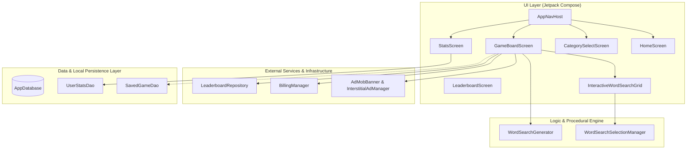

# SimplySeek — As-Built System Specification & Architecture Document

> **Document Type:** As-Built Technical Specification  
> **Application:** SimplySeek (Tech-Fluid Word Search)  
> **Package Name:** `com.squarestudios.simplyseek`  
> **Current Version:** `0.19.0` (Build Version Code `1`)  
> **Status:** Living Document (Working Reference)  
> **Last Updated:** 2026-11-03  

---

> [!IMPORTANT]
> **Living Document Maintenance Protocol:**  
> This file is a **mandatory working document**. Whenever new features, bug fixes, third-party integrations, database schema modifications, or architectural refactorings are implemented, this file must be updated in sync with [`CHANGELOG.md`](CHANGELOG.md) to ensure documentation integrity across development cycles.

---

## 1. Executive Summary & Application Overview

**SimplySeek** is a native Android word search puzzle game built entirely using modern Android standards: **Jetpack Compose (Material 3)**, **Kotlin Coroutines/Flows**, **Room Database**, and a procedural generation engine.

Visually, the game adopts a cybernetic **"Tech Fluid"** aesthetic characterized by deep obsidian backgrounds, high-contrast neon cyan and purple accents, illuminated grid tiles, multi-colored laser highlights, and reactive animations.

### Core Value Proposition
- Procedural, infinite word search generation across customizable themes and difficulty tiers.
- Highly responsive touch/drag selection with 8-directional angular snapping.
- Visual discovery tracking with persistent multi-color highlight capsules on the board and live-updated target word chips.
- Offline game saves and lifetime progression stats, supplemented by global Firestore leaderboards, Google Play Billing (ad removal), and Google AdMob monetization.

---

## 2. Infrastructure & Technology Stack

| Layer | Component / Library | Version | Purpose |
| :--- | :--- | :--- | :--- |
| **Operating System** | Android OS | Min SDK 24 (Nougat) / Target & Compile SDK 35 (Android 15) | Core OS platform compatibility |
| **Language & Toolchain** | Kotlin | `2.2.10` (JVM Target 11) | Primary application programming language |
| **Build System** | Android Gradle Plugin (AGP) | `9.5.0` | Build orchestration and compilation |
| **UI Framework** | Jetpack Compose (BoM) | `2025.02.00` | Declarative UI, gesture detection, and custom Canvas drawing |
| **Design System** | Material 3 (`androidx.compose.material3`) | BoM-managed | Base typography, surface theming, and layout primitives |
| **Navigation** | Navigation Compose | `2.8.8` | Single-activity screen routing and type-safe argument passing |
| **Persistence (Local)**| AndroidX Room | `2.8.5` | Local SQLite database for saved games and lifetime player stats (processed via Kotlin KAPT `org.jetbrains.kotlin.kapt`) |
| **JSON Serialization**| Google Gson | `2.15.0` | Room TypeConverters for matrix/list persistence |
| **Advertising** | Google Play Services Ads | `23.6.0` | AdMob Banner and Interstitial ad display |
| **In-App Billing** | Google Play Billing KTX | `7.1.1` | In-app purchases (One-time "Remove Ads" entitlement) |
| **Cloud Database** | Firebase Firestore KTX | BoM `33.10.0` | Real-time global leaderboards and score aggregation |
| **Authentication** | Firebase Auth KTX & Android Credential Manager | BoM `33.10.0` / `1.5.0` | One-tap Google Sign-In and verified player accounts |
| **Image Loading** | Coil Compose | `2.7.0` | Asynchronous rendering of verified Google player avatars |

---

## 3. High-Level System Architecture

SimplySeek implements a unidirectional data flow (UDF) inspired by clean architecture and Android Jetpack guidelines.



---

## 4. Core Functional Modules

### 4.1. Procedural Grid Generator (`WordSearchGenerator`)
Located in [`WordSearchGenerator.kt`](app/src/main/java/com/squarestudios/simplyseek/generator/WordSearchGenerator.kt):
- **Algorithm**: Populates a square matrix of size $N \times N$ ($8 \times 8$ for Easy, $9 \times 9$ for Medium, $10 \times 10$ for Hard).
- **8-Directional Placement**:
  - Horizontal (`FORWARD`, `BACKWARD`)
  - Vertical (`FORWARD`, `BACKWARD`)
  - Diagonal (`DOWN_RIGHT`, `UP_LEFT`, `DOWN_LEFT`, `UP_RIGHT`)
- **Collision & Intersection Validation**: Words can intersect if overlapping cells share identical characters.
- **Filling Strategy**: Unoccupied matrix cells are filled with random uppercase ASCII letters `A`-`Z`.
- **Output**: Returns an immutable [`GridState`](app/src/main/java/com/squarestudios/simplyseek/model/WordSearchModels.kt) containing the populated `List<List<Cell>>` and the list of successfully placed target words.

### 4.2. Selection & Touch Engine (`WordSearchSelectionManager` & `InteractiveWordSearchGrid`)
Located in [`WordSearchGrid.kt`](app/src/main/java/com/squarestudios/simplyseek/ui/components/WordSearchGrid.kt) and [`WordSearchSelectionManager.kt`](app/src/main/java/com/squarestudios/simplyseek/logic/WordSearchSelectionManager.kt):
- **Dynamic Auto-Scaling**: Evaluates screen constraints using `BoxWithConstraints`. Automatically calculates square cell dimensions `cellSize = ((availableWidth - totalSpacing) / numCols).coerceIn(24.dp, 46.dp)` with tight 6.dp padding and 2.dp cell spacing to maximize playable area on phone screens.
- **Enlarged Typography**: Tiles feature extra-bold monospace text sized at `58%` of the cell dimension (`cellSize * 0.58f`), producing ~19sp to 24sp letters for maximum legibility and effortless thumb/finger selection.
- **Symmetric Center Snapping**: Touch offsets are normalized against cell centers (`(offset - (padding + cellSize / 2)) / cellStep`) with nearest-integer rounding, providing symmetric, forgiving selection across all 8 directions.
- **Ray-Cast Snapping**: Touch drag offsets are converted into angles $\theta = \text{atan2}(\Delta y, \Delta x)$ and snapped to the nearest 45° step ($\text{round}(\theta / \frac{\pi}{4}) \cdot \frac{\pi}{4}$).
- **Bidirectional Word Matching**: `checkWordMatch` validates words extracted both forwards and backwards against target lists while preventing duplicate registrations.

### 4.3. Visual Selection Styles (`SelectionStyle`)
The board supports multiple player-selectable visual presentation modes:
1. `ILLUMINATED_TILES`: Individual letter tiles illuminate with glowing background fills and neon borders.
2. `LASER_LINE`: Ultra-sharp 4.dp high-visibility neon laser filament with finger tracking.
3. `CAPSULE_OUTLINE`: Hollow rounded frame encasing the selection.
4. `CLASSIC_HIGHLIGHT`: Semi-transparent broad highlighter line.

### 4.4. Permanent Highlighting & Word Tracking System (v0.12.0)
- **Multi-Color Found Word Palette (`FoundWordColors`)**: Discovered words are sequentially assigned distinct, highly saturated neon colors:
  - Neon Mint / Emerald (`0xFF00E676`)
  - Electric Neon Cyan (`0xFF00E5FF`)
  - Bright Lemon Gold (`0xFFFFD600`)
  - Vivid Neon Pink (`0xFFFF4081`)
  - Neon Lavender / Violet (`0xFFB388FF`)
  - Neon Amber / Tangerine (`0xFFFF9100`)
  - Vivid Sky Blue (`0xFF00B0FF`)
  - Vibrant Lime (`0xFF76FF03`)
- **Dual-Layer Board Highlighting**:
  - **Tile Level**: Cells belonging to discovered words animate into colored translucent backgrounds and glowing borders.
  - **Canvas Level**: A translucent rounded capsule (`strokeWidth = 0.78 * cellSize`) and bright 3.dp inner laser line span from the word's start cell to end cell, remaining permanently visible regardless of active drag style.
- **Interactive Word HUD**:
  - **`FlowRow` Word Chips**: Each target word is displayed in a dedicated chip. When found, the chip lights up with the matching neon color, receives a checkmark prefix (`✓`), and renders strikethrough text (`TextDecoration.LineThrough`).
  - **Progress Bar**: `LinearProgressIndicator` dynamically reflects the ratio of found words.
  - **Puzzle Completion Card**: Triggers an animated celebration dialog offering one-tap `"PLAY NEXT PUZZLE"` generation.

### 4.5. Endless Category & Fandom Catalog Architecture (`CategoryCatalog`) (v0.13.0, v0.16.0, v0.18.0)
Located in [`CategoryCatalog.kt`](app/src/main/java/com/squarestudios/simplyseek/model/CategoryCatalog.kt):
- **Expanded Deep Category Catalog**: Organizes over **1,600+ curated, clean uppercase words** across **26 distinct playable categories** (each populated with **60–80 curated words**) classified across 5 filter groups:
  - **Movies & TV** (`CategoryGroup.MOVIES_TV`):
    - `harry_potter`: Harry Potter (50 words) — Hogwarts, Gryffindor, Slytherin, Ravenclaw, Hufflepuff, Dumbledore, Voldemort, Hermione, Ron, Quidditch, Snitch, Horcrux, Patronus, Hedwig, Hagrid, Azkaban, etc.
    - `big_bang_theory`: The Big Bang Theory (44 words) — Sheldon, Leonard, Penny, Howard, Raj, Amy, Bernadette, Bazinga, Caltech, Pasadena, String, Physics, Cheesecake, Comic, Klingon, etc.
    - `lord_of_the_rings`: Lord of the Rings (40 words) — Frodo, Aragorn, Gandalf, Legolas, Gimli, Sauron, Mordor, Rivendell, Gondor, Rohan, Gollum, Ring, Shire, Nazgul, Mithril, etc.
    - `star_wars`: Star Wars (40 words) — Skywalker, Vader, Yoda, Kenobi, Solo, Chewbacca, Palpatine, Jedi, Sith, Lightsaber, Falcon, Droid, Xwing, Tatooine, etc.
    - `the_office`: The Office (40 words) — Michael, Dwight, Jim, Pam, Andy, Stanley, Angela, Scranton, Dunder, Mifflin, Dundies, Sabre, Beet, Prank, Threat, etc.
    - `friends_tv`: Friends (36 words) — Ross, Rachel, Monica, Chandler, Joey, Phoebe, Central, Perk, Smelly, Geller, Tribbiani, Gunther, Lobster, Pivot, etc.
    - `breaking_bad`: Breaking Bad (36 words) — Heisenberg, Walter, Jesse, Pinkman, Gus, Fring, Saul, Goodman, Hank, Schrader, Pollos, Hermanos, Meth, RV, etc.
    - `stranger_things`: Stranger Things (35 words) — Eleven, Mike, Dustin, Lucas, Will, Hopper, Joyce, Hawkins, Upside, Down, Demogorgon, Mindflayer, Eggo, Arcade, etc.
  - **Tech & Gaming**:
    - `computer_hardware`: CPU, GPU, RAM, Motherboard, SSD, Heatsink, Cooler, Chipset, Optical, Transistor...
    - `software_coding`: Kotlin, Python, Compiler, Debugger, Coroutine, Recursion, Database, Algorithm...
    - `gaming_classics`: Mario, Zelda, Pokemon, Skyrim, Portal, Doom, Minecraft, Witcher, Fallout...
    - `playstation_hits`: God of War, Uncharted, Spiderman, Bloodborne, Horizon, Ratchet, Tsushima...
    - `xbox_franchises`: Halo, Forza, Gears, Fable, Starfield, Crackdown, Hellblade, Sea of Thieves...
    - `pokemon_world`: Pikachu, Charizard, Blastoise, Venusaur, Mewtwo, Gengar, Eevee, Snorlax, Lucario, Kanto, Johto, Pokeball, Gym...
  - **Pop Culture**:
    - `marvel_universe`: Iron Man, Captain, Thor, Hulk, Hawkeye, Natasha, Thanos, Wakanda, Asgard, Vibranium, Infinity, Stones, Avenger...
    - `anime_legends`: Naruto, Sasuke, Goku, Vegeta, Luffy, Zoro, Tanjiro, Nezuko, Eren, Levi, Deku, Bakugo, Saitama, Shinigami, Chakra...
    - `movies_cinema`: Inception, Matrix, Interstellar, Gladiator, Titanic, Terminator, Jurassic...
    - `comic_characters`: Batman, Superman, Spiderman, Wolverine, Deadpool, Thor, Daredevil, Joker...
    - `food_culinary`: Pizza, Sushi, Burger, Ramen, Croissant, Lasagna, Risotto, Tiramisu...
    - `music_rock`: Beatles, Queen, Nirvana, Metallica, Pink Floyd, Led Zeppelin, Radiohead...
  - **Automotive**:
    - `car_makes`: Ferrari, Porsche, Lamborghini, Toyota, BMW, Mercedes, Audi, McLaren, Bugatti...
    - `car_engine`: Piston, Camshaft, Crankshaft, Cylinder, Turbo, Radiator, Alternator, Supercharger...
  - **Science & Nature**:
    - `science_physics`: Atom, Electron, Gravity, Quantum, Photon, Fusion, Relativity, Entropy...
    - `deep_space`: Galaxy, Nebula, Supernova, Black Hole, Asteroid, Andromeda, Pulsar, Cosmos...
    - `wild_animals`: Cheetah, Elephant, Kangaroo, Leopard, Falcon, Dolphin, Chameleon, Octopus...
    - `world_wonders`: Everest, Amazon, Sahara, Nile, Colosseum, Pyramids, Volcano, Archipelago...
- **Infinite Replayability Sampling & Sequential Indexing**:
  - `CategoryCatalog.getWordsForCategory(categoryId, difficulty, seed)` filters candidate words by grid length ($L \le 8$ for Easy, $L \le 9$ for Medium, $L \le 10$ for Hard) and shuffles with a deterministic seed.
  - Deep pools of 60–80 words per category ensure dozens of non-overlapping puzzles and millions of unique combinations per difficulty tier.
  - Clicking `"NEW PUZZLE"` or `"PLAY NEXT PUZZLE"` increments `puzzleSeed`, updating the header badge (`DIFFICULTY: ${difficulty.uppercase()} • PUZZLE #${puzzleSeed + 1}`) and regenerating an entirely distinct procedural layout.
- **Topic Selection UI (`CategorySelectScreen`)**:
  - Filter group tabs (`ALL`, `TECH & GAMING`, `AUTOMOTIVE`, `POP CULTURE`, `MOVIES & TV`, `SCIENCE & NATURE`).
  - Interactive cards featuring category icons, titles, word counts, and sample words.
  - Tiered difficulty selection with grid size dimensions (`8x8 • 6W`, `9x9 • 8W`, `10x10 • 13W`).

### 4.6. Home Dashboard & User Progression Engine (`HomeScreen` & `UserStatsRepository`) (v0.14.0)
Located in [`HomeScreen.kt`](app/src/main/java/com/squarestudios/simplyseek/ui/screens/HomeScreen.kt) and [`UserStatsRepository.kt`](app/src/main/java/com/squarestudios/simplyseek/db/repository/UserStatsRepository.kt):
- **Live User Stats Dashboard**:
  - Automatically queries the Room database via `UserStatsDao` using reactive Kotlin Flows (`observeUserStats`).
  - **Operator Level & Rank**: Dynamically computes user levels ($Level = \lfloor XP / 250 \rfloor + 1$) and titles (`Novice Seeker`, `Grid Apprentice`, `Seek Specialist`, `Code Hunter`, `Grid Overlord`, `Cyber Grandmaster`).
  - **Level Progress Indicator**: Real-time `LinearProgressIndicator` visualizing progress towards the next level ($XP \pmod{250}$).
  - **Metrics Grid**: High-contrast cybernetic cards displaying:
    - **Puzzles Solved** (Emerald neon accent)
    - **Consecutive Daily Streak** (Tangerine flame accent with calendar validation)
    - **Mastery Tier** (Violet lavender accent)
  - **Quick Topic Teaser**: Displays available categories count and quick-play direct button.
- **Progression Recording Flow**:
  - [`GameBoardScreen.kt`](app/src/main/java/com/squarestudios/simplyseek/ui/screens/GameBoardScreen.kt) triggers `UserStatsRepository.recordPuzzleCompleted(difficulty)` upon all target words being discovered.
  - Awards XP scaled by difficulty (+50 XP for Easy, +100 XP for Medium, +150 XP for Hard), increments solved count, and validates consecutive daily streak.
- **Career Stats Screen (`StatsScreen.kt`)**:
  - Re-architected with reactive Room data observation, level tier cards, and detailed metric breakdown cards.

### 4.7. Tactile Haptic Feedback Engine (`GameHapticFeedback`) (v0.17.0)
Located in [`GameHapticFeedback.kt`](app/src/main/java/com/squarestudios/simplyseek/ui/haptics/GameHapticFeedback.kt):
- **Tactile Grid Selection Ticks**:
  - Every time the player's drag path spans across or retracts from a letter cell in [`InteractiveWordSearchGrid`](app/src/main/java/com/squarestudios/simplyseek/ui/components/WordSearchGrid.kt), `haptics.performTileTick()` triggers an immediate, crisp physical click.
  - Multi-tier API resolution leverages `HapticFeedbackConstants.SEGMENT_TICK` (API 34+), `TEXT_HANDLE_MOVE` (API 27+), or `CLOCK_TICK`, augmented by fallback to hardware `Vibrator` / `VibratorManager` (`EFFECT_TICK`).
  - Enforces a 35ms debounce threshold to eliminate high-frequency boundary jitter while preserving rapid swiping accuracy.
- **Gesture Start Tap**:
  - Touching down on an initial letter cell fires `haptics.performSelectionStart()`, producing an instant tactile contact impulse (`GESTURE_START` / `KEYBOARD_TAP`).
- **Word Discovered Confirmation**:
  - Successfully completing and releasing a valid target word triggers `haptics.performWordFoundSuccess()`, delivering a distinct, celebratory double-pulse haptic vibration (`CONFIRM` / waveform vibration).
- **Interface & Testability**:
  - Encapsulated behind `HapticFeedbackController` with a testable `NoOpHapticFeedbackController` implementation.
  - Requires and declares `<uses-permission android:name="android.permission.VIBRATE" />` in [`AndroidManifest.xml`](app/src/main/AndroidManifest.xml).

---

## 5. Third-Party Services & Integrations

### 5.1. Google AdMob Monetization
- **Application ID**: `ca-app-pub-3940256099942544~3347511713` (configured in [`AndroidManifest.xml`](app/src/main/AndroidManifest.xml)).
- **Banner Ads (`AdMobBanner.kt`)**: Embedded at the footer of [`GameBoardScreen`](app/src/main/java/com/squarestudios/simplyseek/ui/screens/GameBoardScreen.kt). Contains a `LocalInspectionMode.current` guard to ensure Android Studio Compose previews render without invoking native Play Services.
- **Interstitial Ads (`InterstitialAdManager.kt`)**: Preloads full-screen video/display ads to display on level transitions or returns to home.

### 5.2. Google Play Billing Library
- **Manager (`BillingManager.kt`)**: Encapsulates `BillingClient` lifecycle, query operations, and purchase acknowledgment.
- **Product Details**:
  - SKU: `premium_remove_ads` (One-time, non-consumable In-App Purchase).
- **Entitlement State**: Exposes `isRemoveAdsPurchased: StateFlow<Boolean>` for reactive UI updates and ad suppression.

### 5.3. Firebase Firestore Global Leaderboards & Real-Time Sync (v0.19.0)
- **Repository (`LeaderboardRepository.kt`)**: Interacts with the `"leaderboards"` Firestore collection.
- **Data Model (`LeaderboardEntry.kt`)**: Stores `playerName`, `timeInSeconds`, `difficulty`, `timestamp`, `userId`, `userPhotoUrl`, and `categoryTitle`.
- **Real-Time Queries**: `getTopScoresFlow(difficulty)` returns a real-time reactive `Flow` querying top scores ordered by lowest completion time (ascending).
- **Leaderboard UI (`LeaderboardScreen.kt`)**: Filterable by difficulty tier (`EASY`, `MEDIUM`, `HARD`), renders podium badges (#1 Gold, #2 Silver, #3 Bronze), player avatar images via Coil (`AsyncImage`), category labels, and solve times (`01:24`).

### 5.4. Google Authentication & Player Accounts (`AuthRepository.kt`) (v0.19.0)
- **Engine**: Modern Android Credential Manager (`androidx.credentials`) integrating `GetGoogleIdOption` and Firebase `GoogleAuthProvider`.
- **Session State**: Exposes `currentUser: StateFlow<FirebaseUser?>`, `playerName`, `photoUrl`, and `userId`.
- **One-Tap Sign-In / Sign-Out**: Handled seamlessly from the top banner in `LeaderboardScreen.kt`. Enables verified score submissions.

---

## 6. Database Schema & Data Models

### 6.1. Room Database (`simply_seek_database`)
Defined in [`AppDatabase.kt`](app/src/main/java/com/squarestudios/simplyseek/db/AppDatabase.kt) (Version `1`):

#### Table: `saved_games`
| Column | Type | Nullable | Description |
| :--- | :--- | :--- | :--- |
| `id` | `INTEGER` (PK) | No | Single-row save identifier (default `1L`) |
| `grid` | `TEXT` | No | 2D JSON matrix of `Cell` objects serialized via Gson |
| `targetWords` | `TEXT` | No | JSON array of target word strings |
| `elapsedTimeSeconds` | `INTEGER` | No | Accumulated play time |
| `difficultyLevel` | `TEXT` | No | Selected difficulty string |
| `updatedAt` | `INTEGER` | No | Timestamp in epoch milliseconds |

#### Table: `user_stats`
| Column | Type | Nullable | Description |
| :--- | :--- | :--- | :--- |
| `id` | `INTEGER` (PK) | No | Player statistics identifier (default `1L`) |
| `totalXp` | `INTEGER` | No | Accumulated experience points |
| `totalPuzzlesCompleted` | `INTEGER` | No | Count of successfully finished puzzles |
| `currentDailyStreak` | `INTEGER` | No | Consecutive active days streak |
| `lastStreakDate` | `TEXT` | No | Date string formatted `YYYY-MM-DD` |

---

## 7. UI Design System & Styling Tokens

All screens adhere to the custom **Tech Fluid / Cybernetic** theme:

```kotlin
// Primary Theme Tokens
val TechDarkBackground      = Color(0xFF0B0D14) // Deep obsidian surface
val TechContainerBackground = Color(0xFF131722) // Elevated container surface
val TechTileBackground      = Color(0xFF1B2030) // Inactive tile/chip surface
val TechButtonNeon          = Color(0xFF00E5FF) // Primary neon cyan action color
val TechTextCyan            = Color(0xFF80D8FF) // Secondary high-legibility cyan
val TechGold                = Color(0xFFFFD600) // Victory and achievement gold
```

- **Typography**: Heavy usage of monospace typography (`FontFamily.Monospace`) for authentic terminal/arcade feel.
- **Shapes & Elevation**: Rounded corners (`RoundedCornerShape(8.dp)` to `16.dp`) bounded by subtle gradient borders (`Brush.linearGradient`).

---

## 8. Directory & Package Structure

```text
com.squarestudios.simplyseek/
├── MainActivity.kt                     # Single Activity host running Jetpack Compose
├── SimplySeekApplication.kt            # Application subclass initializing MobileAds & AppDatabase
├── ads/
│   ├── AdMobBanner.kt                  # Composable banner ad wrapper with preview fallback
│   └── InterstitialAdManager.kt        # Preloader and dispatcher for interstitial ads
├── auth/
│   └── AuthRepository.kt               # Google Sign-In & Credential Manager player account manager
├── billing/
│   └── BillingManager.kt               # Play Billing client wrapper for "Remove Ads"
├── db/
│   ├── AppDatabase.kt                  # Room Database singleton definition
│   ├── converter/
│   │   └── Converters.kt               # Gson TypeConverters for Room (Grid & Word lists)
│   ├── dao/
│   │   ├── SavedGameDao.kt             # DAO for session checkpoint persistence
│   │   └── UserStatsDao.kt             # DAO for XP and streak accumulation
│   ├── entity/
│   │   ├── SavedGame.kt                # Saved game Room entity
│   │   └── UserStats.kt                # Player stats Room entity
│   └── repository/
│       └── UserStatsRepository.kt      # Progression logic, streak tracking, and Room repository
├── generator/
│   └── WordSearchGenerator.kt          # 8-directional procedural puzzle generator
├── leaderboard/
│   ├── LeaderboardEntry.kt             # Firestore leaderboard entry data class
│   └── LeaderboardRepository.kt        # Firestore real-time leaderboard queries
├── logic/
│   └── WordSearchSelectionManager.kt   # Ray-casting, coordinate math, and string verification
├── model/
│   ├── CategoryCatalog.kt              # 26 topic categories and dynamic word bank sampling (1,600+ words)
│   └── WordSearchModels.kt             # Core data classes (Cell, FoundWord, GridState)
├── navigation/
│   ├── AppNavHost.kt                   # NavHost declaring routes and transitions
│   └── Screen.kt                       # Sealed class of application destination routes
└── ui/
    ├── components/
    │   └── WordSearchGrid.kt           # Interactive grid, Canvas renderer, and CellTile
    ├── haptics/
    │   └── GameHapticFeedback.kt       # Tactile feedback engine and HapticFeedbackController
    └── screens/
        ├── CategorySelectScreen.kt     # Scrollable topic category and difficulty selector
        ├── GameBoardScreen.kt          # Active puzzle screen with word tracking HUD & stopwatch
        ├── HomeScreen.kt               # Cybernetic home dashboard displaying live player stats
        ├── LeaderboardScreen.kt        # Worldwide speedrun rankings with Google Auth & tier tabs
        └── StatsScreen.kt              # Detailed player progression and career stats overview
```

---

## 9. Verification & Quality Assurance

- **Unit Testing**: Located in `app/src/test/java/...`:
  - `UserStatsRepositoryTest`: Validates initial stats initialization, XP rewards by difficulty, and puzzle counts.
  - `CategoryCatalogTest`: Verifies category population, group filtering, difficulty length bounds, and seed determinism.
  - `WordSearchGeneratorTest`: Verifies grid boundary enforcement, target word density, and letter constraints.
  - `WordSearchSelectionManagerTest`: Validates forward, reverse, and diagonal word extraction and boundary containment.
  - `GameHapticFeedbackTest`: Validates haptic event recording, null-safety, and No-Op fallback behavior.
  - `LeaderboardEntryTest`: Validates data serialization defaults and fields on leaderboard entries.
  - `ConvertersTest`: Verifies Gson round-trip serialization of 2D `Cell` grids and string lists.
  - `ModelTests`: Asserts immutability and copy behavior.
- **Visual Testing**: Fully verified Compose Previews (`HomeScreenPreview`, `StatsScreenPreview`, `CategorySelectScreenPreview`, `GameBoardScreenPreview`, `InteractiveWordSearchGridPreview`, `GameBoardScreenWithFoundPreview`) using Android Studio Compose Preview rendering.
- **Build Verification**: Continuously validated via Gradle tasks `app:compileDebugKotlin` and `:app:testDebugUnitTest`.

---

## 10. Change History & Maintenance Record

| Version | Date | Description | Impacted Components |
| :--- | :--- | :--- | :--- |
| **v0.8.0** | 2026-10-28 | Google AdMob Banner & Interstitial integration | `SimplySeekApplication`, `ads/` |
| **v0.9.0** | 2026-10-28 | Google Play Billing Library Remove Ads purchase | `billing/BillingManager` |
| **v0.10.0**| 2026-10-28 | Firebase Firestore Global Leaderboards | `leaderboard/` |
| **v0.11.0**| 2026-10-30 | Multi-Style Selection System (`SelectionStyle`) | `ui/components/WordSearchGrid` |
| **v0.12.0**| 2026-10-30 | Persistent multi-color highlighting & interactive word tracking HUD | `WordSearchGrid`, `GameBoardScreen`, `AdMobBanner` |
| **v0.12.1**| 2026-10-30 | Initial creation of this As-Built document | `AS_BUILT.md` |
| **v0.13.0**| 2026-10-30 | Endless Category Catalog (15 categories, 350+ words, filter groups, replayable seed sampling) | `CategoryCatalog`, `CategorySelectScreen`, `GameBoardScreen`, `CategoryCatalogTest` |
| **v0.14.0**| 2026-11-03 | Live Home Dashboard with Operator Level, XP, Solved Count, and Daily Streak | `HomeScreen`, `StatsScreen`, `UserStatsRepository`, `GameBoardScreen`, `UserStatsRepositoryTest` |
| **v0.14.1**| 2026-11-03 | Configured Kotlin KAPT annotation processor (`org.jetbrains.kotlin.kapt`) for Room compiler (`kapt(libs.room.compiler)`), resolving startup crash caused by missing `AppDatabase_Impl` | `build.gradle.kts`, `app/build.gradle.kts` |
| **v0.15.0**| 2026-11-03 | Edge-to-edge system insets alignment, mobile grid tier resizing (8x8 Easy, 9x9 Medium, 10x10 Hard), boosted typography (0.58 ratio), and symmetric center-based touch snapping | `MainActivity`, `CategorySelectScreen`, `GameBoardScreen`, `HomeScreen`, `StatsScreen`, `WordSearchGrid`, `CategoryCatalog` |
| **v0.15.1**| 2026-11-03 | Expanded target word density (6 Easy, 8 Medium, 13 Hard), dense placement fallback engine, and expanded word pools (430+ words) | `CategoryCatalog`, `WordSearchGenerator`, `CategorySelectScreen`, `CategoryCatalogTest`, `WordSearchGeneratorTest` |
| **v0.16.0**| 2026-11-03 | Fandom and franchise catalog expansion (26 categories, 1,000+ words, Harry Potter, Big Bang Theory, MOVIES_TV group, sequential puzzle indexing) | `CategoryCatalog`, `GameBoardScreen`, `HomeScreen`, `CategoryCatalogTest` |
| **v0.17.0**| 2026-11-03 | Tactile haptic feedback engine for tile circling, selection start, and word found confirmation | `GameHapticFeedback`, `WordSearchGrid`, `AndroidManifest.xml`, `GameHapticFeedbackTest` |
| **v0.18.0**| 2026-11-03 | Massive word pool expansion across all 26 categories (1,600+ words, 60–80 words per category) | `CategoryCatalog`, `HomeScreen`, `CategoryCatalogTest` |
| **v0.19.0**| 2026-11-03 | Live Global Leaderboards & Google Authentication via Credential Manager, solve timer, and score submission | `LeaderboardScreen`, `AuthRepository`, `LeaderboardRepository`, `GameBoardScreen`, `HomeScreen`, `AppNavHost` |
