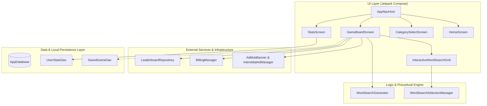

# SimplySeek — As-Built System Specification & Architecture Document

> **Document Type:** As-Built Technical Specification  
> **Application:** SimplySeek (Tech-Fluid Word Search)  
> **Package Name:** `com.squarestudios.simplyseek`  
> **Current Version:** `0.12.0` (Build Version Code `1`)  
> **Status:** Living Document (Working Reference)  
> **Last Updated:** 2026-10-30  

---

> [!IMPORTANT]
> **Living Document Maintenance Protocol:**  
> This file is a **mandatory working document**. Whenever new features, bug fixes, third-party integrations, database schema modifications, or architectural refactorings are implemented, this file must be updated in sync with [`CHANGELOG.md`](CHANGELOG.md) to ensure documentation integrity across development cycles.

---

## 1. Executive Summary & Application Overview

**SimplySeek** is a native Android word search puzzle game built entirely using modern Android standards: **Jetpack Compose (Material 3)**, **Kotlin Coroutines/Flows**, **Room Database**, and a procedural generation engine.

Visually, the game adopts a cybernetic **"Tech Fluid"** aesthetic characterized by deep obsidian backgrounds, high-contrast neon cyan and purple accents, illuminated grid tiles, multi-colored laser highlights, and reactive animations.

### Core Value Proposition
- Procedural, infinite word search generation across customizable themes and difficulty tiers.
- Highly responsive touch/drag selection with 8-directional angular snapping.
- Visual discovery tracking with persistent multi-color highlight capsules on the board and live-updated target word chips.
- Offline game saves and lifetime progression stats, supplemented by global Firestore leaderboards, Google Play Billing (ad removal), and Google AdMob monetization.

---

## 2. Infrastructure & Technology Stack

| Layer | Component / Library | Version | Purpose |
| :--- | :--- | :--- | :--- |
| **Operating System** | Android OS | Min SDK 24 (Nougat) / Target & Compile SDK 35 (Android 15) | Core OS platform compatibility |
| **Language & Toolchain** | Kotlin | `2.2.10` (JVM Target 11) | Primary application programming language |
| **Build System** | Android Gradle Plugin (AGP) | `9.5.0` | Build orchestration and compilation |
| **UI Framework** | Jetpack Compose (BoM) | `2025.02.00` | Declarative UI, gesture detection, and custom Canvas drawing |
| **Design System** | Material 3 (`androidx.compose.material3`) | BoM-managed | Base typography, surface theming, and layout primitives |
| **Navigation** | Navigation Compose | `2.8.8` | Single-activity screen routing and type-safe argument passing |
| **Persistence (Local)**| AndroidX Room | `2.8.5` | Local SQLite database for saved games and lifetime player stats |
| **JSON Serialization**| Google Gson | `2.15.0` | Room TypeConverters for matrix/list persistence |
| **Advertising** | Google Play Services Ads | `23.6.0` | AdMob Banner and Interstitial ad display |
| **In-App Billing** | Google Play Billing KTX | `7.1.1` | In-app purchases (One-time "Remove Ads" entitlement) |
| **Cloud Database** | Firebase Firestore KTX | BoM `33.10.0` | Real-time global leaderboards and score aggregation |

---

## 3. High-Level System Architecture

SimplySeek implements a unidirectional data flow (UDF) inspired by clean architecture and Android Jetpack guidelines.



---

## 4. Core Functional Modules

### 4.1. Procedural Grid Generator (`WordSearchGenerator`)
Located in [`WordSearchGenerator.kt`](app/src/main/java/com/squarestudios/simplyseek/generator/WordSearchGenerator.kt):
- **Algorithm**: Populates a square matrix of size $N \times N$ ($8 \times 8$ for Easy, $10 \times 10$ for Medium, $12 \times 12$ for Hard).
- **8-Directional Placement**:
  - Horizontal (`FORWARD`, `BACKWARD`)
  - Vertical (`FORWARD`, `BACKWARD`)
  - Diagonal (`DOWN_RIGHT`, `UP_LEFT`, `DOWN_LEFT`, `UP_RIGHT`)
- **Collision & Intersection Validation**: Words can intersect if overlapping cells share identical characters.
- **Filling Strategy**: Unoccupied matrix cells are filled with random uppercase ASCII letters `A`-`Z`.
- **Output**: Returns an immutable [`GridState`](app/src/main/java/com/squarestudios/simplyseek/model/WordSearchModels.kt) containing the populated `List<List<Cell>>` and the list of successfully placed target words.

### 4.2. Selection & Touch Engine (`WordSearchSelectionManager` & `InteractiveWordSearchGrid`)
Located in [`WordSearchGrid.kt`](app/src/main/java/com/squarestudios/simplyseek/ui/components/WordSearchGrid.kt) and [`WordSearchSelectionManager.kt`](app/src/main/java/com/squarestudios/simplyseek/logic/WordSearchSelectionManager.kt):
- **Dynamic Auto-Scaling**: Evaluates screen constraints using `BoxWithConstraints`. Automatically calculates square cell dimensions `cellSize = ((availableWidth - totalSpacing) / numCols).coerceIn(22.dp, 42.dp)` to guarantee no clipping or letter truncation across all screen form factors.
- **Ray-Cast Snapping**: Touch drag offsets are converted into angles $\theta = \text{atan2}(\Delta y, \Delta x)$ and snapped to the nearest 45° step ($\text{round}(\theta / \frac{\pi}{4}) \cdot \frac{\pi}{4}$).
- **Bidirectional Word Matching**: `checkWordMatch` validates words extracted both forwards and backwards against target lists while preventing duplicate registrations.

### 4.3. Visual Selection Styles (`SelectionStyle`)
The board supports multiple player-selectable visual presentation modes:
1. `ILLUMINATED_TILES`: Individual letter tiles illuminate with glowing background fills and neon borders.
2. `LASER_LINE`: Ultra-sharp 4.dp high-visibility neon laser filament with finger tracking.
3. `CAPSULE_OUTLINE`: Hollow rounded frame encasing the selection.
4. `CLASSIC_HIGHLIGHT`: Semi-transparent broad highlighter line.

### 4.4. Permanent Highlighting & Word Tracking System (v0.12.0)
- **Multi-Color Found Word Palette (`FoundWordColors`)**: Discovered words are sequentially assigned distinct, highly saturated neon colors:
  - Neon Mint / Emerald (`0xFF00E676`)
  - Electric Neon Cyan (`0xFF00E5FF`)
  - Bright Lemon Gold (`0xFFFFD600`)
  - Vivid Neon Pink (`0xFFFF4081`)
  - Neon Lavender / Violet (`0xFFB388FF`)
  - Neon Amber / Tangerine (`0xFFFF9100`)
  - Vivid Sky Blue (`0xFF00B0FF`)
  - Vibrant Lime (`0xFF76FF03`)
- **Dual-Layer Board Highlighting**:
  - **Tile Level**: Cells belonging to discovered words animate into colored translucent backgrounds and glowing borders.
  - **Canvas Level**: A translucent rounded capsule (`strokeWidth = 0.78 * cellSize`) and bright 3.dp inner laser line span from the word's start cell to end cell, remaining permanently visible regardless of active drag style.
- **Interactive Word HUD**:
  - **`FlowRow` Word Chips**: Each target word is displayed in a dedicated chip. When found, the chip lights up with the matching neon color, receives a checkmark prefix (`✓`), and renders strikethrough text (`TextDecoration.LineThrough`).
  - **Progress Bar**: `LinearProgressIndicator` dynamically reflects the ratio of found words.
  - **Puzzle Completion Card**: Triggers an animated celebration dialog offering one-tap `"PLAY NEXT PUZZLE"` generation.

---

## 5. Third-Party Services & Integrations

### 5.1. Google AdMob Monetization
- **Application ID**: `ca-app-pub-3940256099942544~3347511713` (configured in [`AndroidManifest.xml`](app/src/main/AndroidManifest.xml)).
- **Banner Ads (`AdMobBanner.kt`)**: Embedded at the footer of [`GameBoardScreen`](app/src/main/java/com/squarestudios/simplyseek/ui/screens/GameBoardScreen.kt). Contains a `LocalInspectionMode.current` guard to ensure Android Studio Compose previews render without invoking native Play Services.
- **Interstitial Ads (`InterstitialAdManager.kt`)**: Preloads full-screen video/display ads to display on level transitions or returns to home.

### 5.2. Google Play Billing Library
- **Manager (`BillingManager.kt`)**: Encapsulates `BillingClient` lifecycle, query operations, and purchase acknowledgment.
- **Product Details**:
  - SKU: `premium_remove_ads` (One-time, non-consumable In-App Purchase).
- **Entitlement State**: Exposes `isRemoveAdsPurchased: StateFlow<Boolean>` for reactive UI updates and ad suppression.

### 5.3. Firebase Firestore Global Leaderboards
- **Repository (`LeaderboardRepository.kt`)**: Interacts with the `"leaderboards"` Firestore collection.
- **Data Model (`LeaderboardEntry.kt`)**: Stores `playerName`, `timeInSeconds`, `difficulty`, and `timestamp`.
- **Real-Time Queries**: `getTopScoresFlow(difficulty)` returns a real-time reactive `Flow` querying top scores ordered by lowest completion time.

---

## 6. Database Schema & Data Models

### 6.1. Room Database (`simply_seek_database`)
Defined in [`AppDatabase.kt`](app/src/main/java/com/squarestudios/simplyseek/db/AppDatabase.kt) (Version `1`):

#### Table: `saved_games`
| Column | Type | Nullable | Description |
| :--- | :--- | :--- | :--- |
| `id` | `INTEGER` (PK) | No | Single-row save identifier (default `1L`) |
| `grid` | `TEXT` | No | 2D JSON matrix of `Cell` objects serialized via Gson |
| `targetWords` | `TEXT` | No | JSON array of target word strings |
| `elapsedTimeSeconds` | `INTEGER` | No | Accumulated play time |
| `difficultyLevel` | `TEXT` | No | Selected difficulty string |
| `updatedAt` | `INTEGER` | No | Timestamp in epoch milliseconds |

#### Table: `user_stats`
| Column | Type | Nullable | Description |
| :--- | :--- | :--- | :--- |
| `id` | `INTEGER` (PK) | No | Player statistics identifier (default `1L`) |
| `totalXp` | `INTEGER` | No | Accumulated experience points |
| `totalPuzzlesCompleted` | `INTEGER` | No | Count of successfully finished puzzles |
| `currentDailyStreak` | `INTEGER` | No | Consecutive active days streak |
| `lastStreakDate` | `TEXT` | No | Date string formatted `YYYY-MM-DD` |

---

## 7. UI Design System & Styling Tokens

All screens adhere to the custom **Tech Fluid / Cybernetic** theme:

```kotlin
// Primary Theme Tokens
val TechDarkBackground      = Color(0xFF0B0D14) // Deep obsidian surface
val TechContainerBackground = Color(0xFF131722) // Elevated container surface
val TechTileBackground      = Color(0xFF1B2030) // Inactive tile/chip surface
val TechButtonNeon          = Color(0xFF00E5FF) // Primary neon cyan action color
val TechTextCyan            = Color(0xFF80D8FF) // Secondary high-legibility cyan
val TechGold                = Color(0xFFFFD600) // Victory and achievement gold
```

- **Typography**: Heavy usage of monospace typography (`FontFamily.Monospace`) for authentic terminal/arcade feel.
- **Shapes & Elevation**: Rounded corners (`RoundedCornerShape(8.dp)` to `16.dp`) bounded by subtle gradient borders (`Brush.linearGradient`).

---

## 8. Directory & Package Structure

```text
com.squarestudios.simplyseek/
├── MainActivity.kt                     # Single Activity host running Jetpack Compose
├── SimplySeekApplication.kt            # Application subclass initializing MobileAds & AppDatabase
├── ads/
│   ├── AdMobBanner.kt                  # Composable banner ad wrapper with preview fallback
│   └── InterstitialAdManager.kt        # Preloader and dispatcher for interstitial ads
├── billing/
│   └── BillingManager.kt               # Play Billing client wrapper for "Remove Ads"
├── db/
│   ├── AppDatabase.kt                  # Room Database singleton definition
│   ├── converter/
│   │   └── Converters.kt               # Gson TypeConverters for Room (Grid & Word lists)
│   ├── dao/
│   │   ├── SavedGameDao.kt             # DAO for session checkpoint persistence
│   │   └── UserStatsDao.kt             # DAO for XP and streak accumulation
│   └── entity/
│       ├── SavedGame.kt                # Saved game Room entity
│       └── UserStats.kt                # Player stats Room entity
├── generator/
│   └── WordSearchGenerator.kt          # 8-directional procedural puzzle generator
├── leaderboard/
│   ├── LeaderboardEntry.kt             # Firestore leaderboard entry data class
│   └── LeaderboardRepository.kt        # Firestore real-time leaderboard queries
├── logic/
│   └── WordSearchSelectionManager.kt   # Ray-casting, coordinate math, and string verification
├── model/
│   └── WordSearchModels.kt             # Core data classes (Cell, FoundWord, GridState)
├── navigation/
│   ├── AppNavHost.kt                   # NavHost declaring routes and transitions
│   └── Screen.kt                       # Sealed class of application destination routes
└── ui/
    ├── components/
    │   └── WordSearchGrid.kt           # Interactive grid, Canvas renderer, and CellTile
    └── screens/
        ├── CategorySelectScreen.kt     # Theme and difficulty selection screen
        ├── GameBoardScreen.kt          # Active puzzle screen with word tracking HUD
        ├── HomeScreen.kt               # Main landing menu
        └── StatsScreen.kt              # Player progression and stats overview
```

---

## 9. Verification & Quality Assurance

- **Unit Testing**: Located in `app/src/test/java/...`:
  - `WordSearchGeneratorTest`: Verifies grid boundary enforcement, target word density, and letter constraints.
  - `WordSearchSelectionManagerTest`: Validates forward, reverse, and diagonal word extraction and boundary containment.
  - `ConvertersTest`: Verifies Gson round-trip serialization of 2D `Cell` grids and string lists.
  - `ModelTests`: Asserts immutability and copy behavior.
- **Visual Testing**: Fully verified Compose Previews (`GameBoardScreenPreview`, `InteractiveWordSearchGridPreview`, `GameBoardScreenWithFoundPreview`) using Android Studio Compose Preview rendering.
- **Build Verification**: Continuously validated via Gradle tasks `app:compileDebugKotlin` and `:app:testDebugUnitTest`.

---

## 10. Change History & Maintenance Record

| Version | Date | Description | Impacted Components |
| :--- | :--- | :--- | :--- |
| **v0.8.0** | 2026-10-28 | Google AdMob Banner & Interstitial integration | `SimplySeekApplication`, `ads/` |
| **v0.9.0** | 2026-10-28 | Google Play Billing Library Remove Ads purchase | `billing/BillingManager` |
| **v0.10.0**| 2026-10-28 | Firebase Firestore Global Leaderboards | `leaderboard/` |
| **v0.11.0**| 2026-10-30 | Multi-Style Selection System (`SelectionStyle`) | `ui/components/WordSearchGrid` |
| **v0.12.0**| 2026-10-30 | Persistent multi-color highlighting & interactive word tracking HUD | `WordSearchGrid`, `GameBoardScreen`, `AdMobBanner` |
| **v0.12.1**| 2026-10-30 | Initial creation of this As-Built document | `AS_BUILT.md` |
